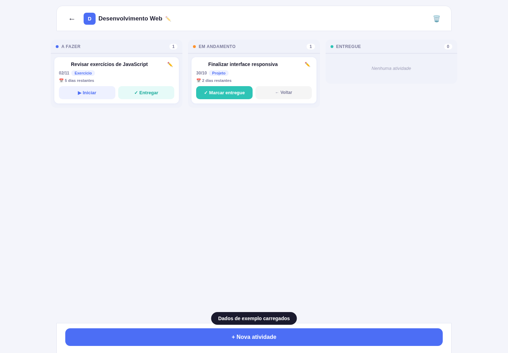
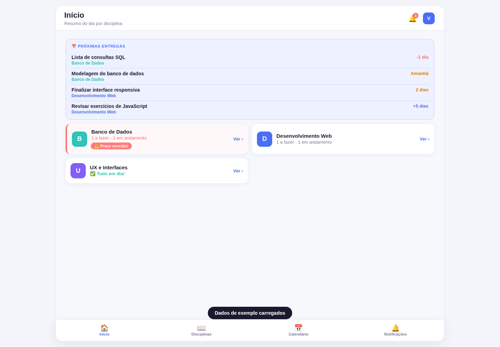

# Studia

Aplicação web acadêmica para organizar disciplinas, atividades e prazos de entrega em um só lugar.

O Studia nasceu como um trabalho da graduação em Análise e Desenvolvimento de Sistemas. O conceito inicial foi criado com apoio do Base44 e, posteriormente, a aplicação web foi desenvolvida em HTML, CSS e JavaScript, com ferramentas de IA generativa utilizadas como apoio na implementação, revisão e evolução das funcionalidades.

## Funcionalidades

- criação e edição de disciplinas com identificação por cores;
- criação, edição e exclusão de atividades, com descrição detalhada e visualização de informações;
- quadro Kanban com os estados **A fazer**, **Em andamento** e **Entregue**;
- movimentação de atividades por **drag and drop no desktop**, mantendo botões de ação para mobile;
- acompanhamento de prazos, incluindo avisos de atividades vencidas e próximas entregas;
- calendário mensal com atividades por data;
- central de notificações para prazos próximos;
- resumo das disciplinas e tarefas na tela inicial;
- perfil local com estatísticas de disciplinas, atividades e entregas;
- opção de carregar dados de exemplo para explorar rapidamente a aplicação;
- persistência dos dados com `localStorage`;
- interface responsiva para celular e desktop.

## Tecnologias

- HTML5
- CSS3
- JavaScript
- Web Storage (`localStorage`)
- Drag and Drop API

## Capturas

### Quadro de atividades

### Tela inicial

## Como executar

O projeto não depende de instalação ou build. Basta clonar o repositório e abrir o arquivo `index.html` em um navegador moderno.

Também pode ser publicado como site estático pelo GitHub Pages.

Na tela inicial, a opção **Explorar com dados de exemplo** preenche automaticamente algumas disciplinas e atividades para facilitar a visualização das principais funcionalidades.

## Armazenamento e acesso

Esta versão foi construída como uma aplicação front-end independente de servidor. O perfil, as disciplinas e as atividades são armazenados localmente no navegador com `localStorage`.

Por isso, não há autenticação em servidor nem sincronização entre dispositivos nesta versão. Essas são evoluções possíveis caso o projeto seja integrado futuramente a um backend.

## Uso de IA no desenvolvimento

Ferramentas de IA foram utilizadas como apoio na concepção, implementação, revisão e testes do projeto. O desenvolvimento envolveu iterações sobre interface, lógica de navegação, gerenciamento das atividades, persistência local e experiência de uso.

## Status

**Aplicação web acadêmica funcional, preparada para demonstração e portfólio.**

Possíveis evoluções futuras:

- backend e banco de dados;
- autenticação de usuários em servidor;
- sincronização entre dispositivos;
- anexos nas atividades;
- notificações push;
- testes automatizados.